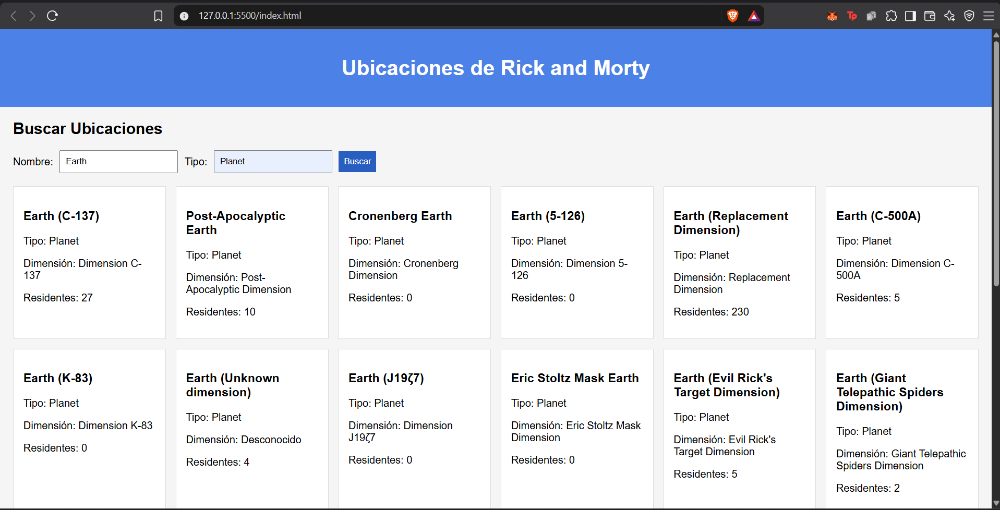

# Ubicaciones de Rick and Morty

Página web que permite buscar ubicaciones de la serie Rick and Morty utilizando una API REST. Los resultados se muestran en tarjetas con información de cada ubicación

**Autor:** Jimena Velázquez  
**Materia:** Fundamentos de Desarrollo Web - UCSA  
**Variante del TP:** B - Ubicaciones

## Sitios publicados

- GitHub Pages: https://351jimenavel.github.io/tp-velazquez-jimena/
- Vercel: https://tp-velazquez-jimena.vercel.app/

## Captura

## Funcionalidades

- Búsqueda de ubicaciones por nombre.
- Filtro por tipo de ubicación.
- Visualización de resultados en tarjetas.
- Mensajes de carga, sin resultados y errores.
- Almacenamiento de la última búsqueda con localStorage.

## Tecnologías

- HTML5
- CSS3
- JavaScript
- Fetch API
- localStorage
- API de Rick and Morty

## Estructura del proyecto

- index.html: estructura de la página.
- css/estilos.css: estilos de la página.
- js/app.js: búsquedas y presentación de resultados.
- img/captura.png: imagen de la aplicación.

## Cómo ejecutarlo localmente

1. Clonar el repositorio:
   git clone https://github.com/351jimenavel/tp-velazquez-jimena.git
2. Abrir la carpeta del proyecto.
3. Abrir index.html en el navegador o utilizar Live Server en VS Code.

## Despliegue

El proyecto se publica desde la rama main mediante GitHub Pages y Vercel. Al subir cambios a GitHub, ambas plataformas actualizan automáticamente la página
